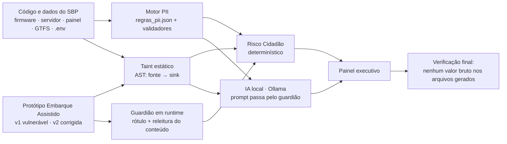

# SBP Guard — Cybersecurity do S.B.P. (Smart Bus Point)

FIAP · Global Solution 2026.2 (CitizenTech) · Engenharia de Software · 3º ano · **Cybersecurity**

**Integrantes**
- Alice Santos Bulhões — RM554499
- Eduardo Oliveira Cardoso Madid — RM556349
- Nicolas Haubricht Hainfellner — RM556259
- Guilherme da Cunha Melo — RM555310

O S.B.P. é um totem de ponto de ônibus para pessoas com deficiência. É exatamente o público cujos dados mais precisam de proteção: uma condição de saúde é **dado sensível** pela LGPD (art. 11). O **SBP Guard** é o módulo de segurança do projeto e cobre as três partes da missão técnica:

| Missão | Onde está | Resultado |
|---|---|---|
| **01 · Mapeamento de PII** | `sbp_guard/regras_pii.json` + `sbp_guard/pii.py` | 12 regras de texto + 8 regras de campo (JSON/.env), com validadores de CPF, Cartão SUS e Luhn. Precisão de 99,5% e recall de 100% em 187 amostras, e **zero falso positivo** nos 28 arquivos (4,6 MB) do SBP real |
| **02 · Taint Analysis** | `sbp_guard/taint_estatico.py` (AST) + `sbp_guard/taint_runtime.py` (guardião) | Acha os 5 vazamentos da versão vulnerável e 0 na corrigida. Em tempo de execução: de **56 dados pessoais vazados para 0**, com 20 saídas bloqueadas e 4/4 pedidos atendidos |
| **03 · Tradução via IA** | `sbp_guard/ia.py` | Um LLM **local** (Ollama · qwen2.5:7b) escreve um alerta para o cidadão por falha, com risco, artigo da LGPD e correção. O prompt passa pelo guardião, então **nenhum dado pessoal vai para a IA** |
| **Dashboard Risco Cidadão** | `painel/index.html` | Índice de 0 a 100 calculado sem IA, com antes e depois: **70 → 11 → 0**. O SBP real fica em 49 |

## Como rodar

Precisa de Python 3.10+, sem nenhuma dependência externa. O Ollama é opcional: sem ele, os alertas usam um texto pronto.

```bash
python -m sbp_guard auditar          # roda tudo e gera painel/ + evidencias/
python -m sbp_guard painel           # abre o painel em http://127.0.0.1:8090 com o botão "Rodar auditoria"
python -m unittest discover -s tests -v   # 20 testes
python prototipo/demo_runtime.py     # só o teste do guardião em tempo de execução
```

Por padrão a auditoria procura o projeto IoT em `../GS2026_IOT_S.P.B`. Para usar outra pasta, passe `--sbp CAMINHO`. Para não chamar o Ollama, use `--sem-ia`.

Para ter os alertas escritos pela IA, instale o [Ollama](https://ollama.com) e rode `ollama pull qwen2.5:7b`. As respostas ficam em `cache_ia.json`, então o mesmo achado sempre gera o mesmo alerta.

## Como funciona



### 01 · Motor de parsing PII
- **Regras declarativas.** Para criar uma regra nova, é só adicionar um item no `regras_pii.json`, sem mexer em código. O teste `test_nova_regra_so_editando_o_json` cria uma regra de Bilhete Único dessa forma.
- **Validadores** que eliminam números parecidos:
  - CPF pelos dígitos verificadores, recusando sequências repetidas;
  - Cartão SUS pelo módulo 11;
  - cartão de crédito pelo algoritmo de Luhn;
  - "segredo plausível", que recusa placeholders como `seu_token_aqui` e `token=token`.
- **Contexto obrigatório para dados de saúde.**
  - "Deficiência visual" só conta se estiver perto de um identificador (CPF, Cartão SUS, e-mail ou telefone) ou de palavras como "paciente", "laudo" ou "CID". Assim "18,6 milhões de pessoas com deficiência" não vira alarme.
  - O nome de uma pessoa só conta perto de um identificador ou de palavras como "passageiro". Assim o nome de uma parada, como "Avenida Cupecê", não é confundido com nome de gente.
- **Formatos lidos:** texto, JSON (por campo, por exemplo `$.cpf`), JSONL, `.env` (sabe se ele está no `.gitignore`) e código.
- **Nenhuma saída mostra o valor encontrado.** Só aparecem a máscara (`***.***.***-**`), o tamanho e uma impressão digital SHA-256 curta.

### 02 · Taint analysis
**Estático (AST).**
- **Fontes:** variável de ambiente com segredo, leitura do `.env`, `input()`, corpo da requisição, payload MQTT e parâmetros como `cpf`, `senha` ou `condicao`.
- **Propagação:** o dado é seguido por atribuições, f-strings, `%`, `+`, `json.loads`/`dumps`, dicionários e atributos `self.x` entre métodos da mesma classe.
- **Sinks (saídas):** `print`, logging, MQTT (com detecção de broker público), arquivo, rede e LLM.
- **Rede:** a análise lê as URLs do código. HTTPS para um destino autorizado é **PERMITIDO**; uma lista com `http://` é **VAZAMENTO**.
- **Sanitizadores reconhecidos:** `mascarar*`, `pseudonimizar`, `hmac`/`hash`, `minimizar*` e `.replace(segredo, "***")`.

**Em tempo de execução (Guardião).**
- Os dados do cidadão recebem um rótulo, `Sensivel(...)`. Toda saída insegura passa pelo guardião, que bloqueia, mascara ou só monitora.
- Uma f-string, `json.dumps` ou `.format()` cria uma string nova e o rótulo se perde. Por isso o guardião também **relê o conteúdo** com o motor de PII antes de deixar sair. Os testes `test_bloqueia_mesmo_quando_fstring_perde_o_rotulo` e `test_bloqueia_json_dumps` provam esses dois casos.

### 03 · Tradução via IA
- Cada falha vira um alerta com quatro partes: título, "Risco para você", LGPD e "Como corrigir".
- A resposta segue um JSON com schema fixo, temperatura 0 e semente fixa.
- Se a IA citar um artigo da LGPD diferente do informado no prompt, o campo é trocado pelo texto validado.
- **A própria IA é tratada como saída insegura.** O prompt leva só metadados mascarados e passa pelo guardião. Se sobrar um CPF ou um dado de saúde, o envio é cancelado.
- O conteúdo analisado vai entre `<achado>…</achado>`, e o modelo é instruído a tratá-lo como dado, não como ordem. Isso protege contra prompt injection vinda do código auditado.
- A escolha por um modelo **local** foi proposital: o relatório de segurança não sai da máquina.

### Dashboard · Risco Cidadão
O índice vai de 0 a 100 e é calculado assim:

`índice = 100 × (1 − e^(−pontos/30))`, com `pontos = severidade × peso do dado × exposição do destino`

Os pesos do dado são: saúde e credencial 1,0; identificação 0,8; contato 0,6. As exposições são: broker público 1,0; HTTP 0,9; IA 0,7; log 0,6; arquivo 0,5; dado parado 0,3. Um vazamento bloqueado pelo guardião vale 10%. O cálculo não usa IA, para que qualquer pessoa possa refazer a conta.

## O que a auditoria encontrou no SBP real
| Severidade | Achado | Onde | Correção sugerida |
|---|---|---|---|
| Crítica | O token da SPTrans pode trafegar sem criptografia: a lista de bases tem `http://` como alternativa e o token vai na URL | `servidor_sbp.py:42`, com uso nas linhas 104 e 126 | Tirar o `http://` de `API_BASES` e falhar se o HTTPS não responder |
| Baixa | Os últimos 4 caracteres do token aparecem no console | `servidor_sbp.py:124` e `:314` | Registrar só "token carregado" |
| Média | Token no `.env` (está no `.gitignore`) | `.env:1` | Manter fora do git e, em produção, usar um cofre de segredos |
| Boa prática | O token é mascarado com `.replace(token, "***")` antes de imprimir erros | `servidor_sbp.py:131` e `:133` | — |

A telemetria MQTT do totem, os eventos de IoB e os 4,6 MB de dados GTFS **não têm dado pessoal**: as presenças são contagens anônimas por hora. O risco aparece quando o projeto cresce. O protótipo **Embarque Assistido** mostra isso: a pessoa pede ajuda para embarcar pelo QR code do totem.

## O protótipo Embarque Assistido
- **`prototipo/embarque_vulneravel.py` (v1)** é vulnerável **de propósito**. Ele envia nome, CPF, condição e telefone para o log, o broker público, a IA, um CSV e o console.
- **`prototipo/embarque_seguro.py` (v2)** aplica as correções:
  - **minimização:** o broker público recebe só ponto, linha e um id;
  - **pseudonimização:** HMAC-SHA256 do CPF;
  - **categoria em vez de diagnóstico:** "apoio_visual";
  - **canal autenticado** para o motorista;
  - **cofre criptografado** para o registro completo.
- **`prototipo/demo_runtime.py`** roda 4 pedidos **fictícios** em 3 cenários: sem proteção, com o guardião e corrigido. Todas as saídas são falsas, em memória, e nada vai para a internet.

## Evidências (`evidencias/`)
- `taint_estatico.txt`: todos os fluxos, de fonte até sink, com linha e trecho de código, mais as sanitizações reconhecidas.
- `taint_runtime.txt`: os eventos do guardião nos 3 cenários (bloqueado, vazou ou permitido), sempre mascarados.
- `alertas_ia.txt`: os alertas escritos pela IA.
- `metricas_motor_pii.json`: precisão e recall por regra.
- `verificacao_sem_segredos.txt`: checagem automática de que nenhum valor sensível encontrado, nem o token real, aparece nos arquivos gerados.
- `testes.txt`: saída dos 20 testes.
- `prints/`: telas do painel, uma por cenário.

## Limites conhecidos
- O corpus de precisão e recall foi escrito pela equipe. Ele mede robustez contra formatos e armadilhas conhecidos, não contra qualquer texto do mundo.
- O taint estático cobre Python. O firmware (C++/Arduino) e o painel (JS) passam só pelo motor PII.
- A análise é intraprocedural, com resumo de retorno de funções e atributos de classe. Não segue dados entre módulos diferentes.
